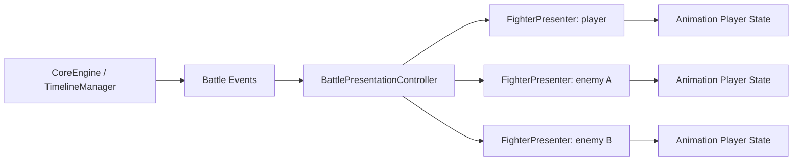
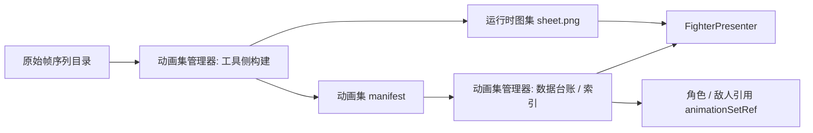

# 帧序列动画播放器与动画集配置补充设计

创建时间：2026-06-06

状态：`补充设计 / 待评审`

关联文档：

- `20-对战演出与动画展示层(battle_presentation)-设计说明.md`
- `16-战斗界面(UI_design)-设计说明.md`
- `21-Spine素材制作工程与导入边界(spine_asset_pipeline)-设计说明.md`
- `S9_动画资产管理/30-动画集管理器(animation_set_manager)-设计说明.md`

归属说明：

本文件描述战斗运行时如何消费帧序列动画和动画集；动画集的导入、构建、数据台账、独立管理界面和服务化接口归入 `S9_动画资产管理`。

## 1. 背景与目标

本补充设计用于明确战斗场景中角色、敌人、友军等战斗单位使用帧序列动画时的系统边界。

当前探索已经证明：用 Spine 或纸娃娃系统可以实现局部动态，但生产链路对原画拆件、骨骼绑定、锚点、动画制作要求较高；而按动作直接生成帧序列的链路更容易被当前 AI 生图流程稳定产出。因此，战斗展示层后续优先把帧序列动画作为主路线验证。

这里要解决的不是“能不能把一组图片播起来”，而是明确：

1. 播放器到底属于全局系统，还是属于每个角色。
2. 播放器从哪里拿数据，由谁驱动，什么时候开始和结束。
3. 多套动作动画如何配置，配置对象来自哪里。
4. 原始帧序列、运行时图集、动画集管理器、角色配置、敌人配置、编辑器配置之间的责任边界。

## 2. 非目标

本补充设计不处理以下问题：

1. 不重新设计战斗规则结算。
2. 不要求时间线等待动画播放结束才能推进。
3. 不在规则层写入任何动画状态。
4. 不继续把 Spine 作为当前验证链路的主路径。
5. 不把 GIF 作为正式战斗动画资源格式。
6. 不要求当前原型一次完成完整编辑器。

## 3. 术语

### 3.1 原始帧序列

原始帧序列是美术或 AI 生图流程产出的源素材目录，例如：

```text
source/character/walk/walk_1.png
source/character/walk/walk_2.png
...
source/character/walk/walk_61.png
```

它的定位是“源素材”，不是正式运行时契约。运行时可以保留逐帧图片播放作为调试或降级能力，但不应该把几十张散图作为长期主路径。

### 3.2 运行时图集

运行时图集是由原始帧序列加工得到的 `spritesheet / atlas`，通常包含：

1. 一张合成后的 `sheet.png`。
2. 一个描述帧宽、高、列数、帧数、帧率、循环方式的 manifest。

运行时图集是战斗展示层优先消费的资源格式。它比直接加载 61 张散图更适合游戏运行时，因为请求数量更少，切换动作更可控，也不会受到 GIF 播放控制能力不足的限制。

### 3.3 动画片段

动画片段是一个可播放动作，例如：

1. `idle`
2. `walk`
3. `attack`
4. `hit`
5. `dead`

动画片段描述“怎么播”，包括资源引用、帧范围、帧率、是否循环、结束后回到哪个动作、显示缩放和偏移。

### 3.4 动画集

动画集是一个角色或敌人可用的全部动画片段集合。

一个角色不应该只绑定一套图片，而应该绑定一个动画集。动画集内部可以包含多套片段，战斗展示层按事件和状态切换片段。

### 3.5 战斗单位播放器

战斗单位播放器不是全局单例，而是每个战斗单位自己的播放实例。当前实现中，这个职责落在 `FighterPresenter` 上。

每个 `FighterPresenter` 负责一个角色或敌人的画面表现，并持有自己的当前片段、当前帧、图层、canvas、图集缓存和 `requestAnimationFrame` 生命周期。

### 3.6 战斗演出控制器

`BattlePresentationController` 是全局演出协调层，但它不是逐帧播放器。

它负责监听战斗事件、识别哪个战斗单位需要表现、把事件翻译成展示命令，然后调用对应 `FighterPresenter` 播放某个动作。

### 3.7 动画集管理器

动画集管理器不是单纯的运行时 registry，也不是单纯的合图脚本。它是帧动画资产从导入、构建、登记、查询、审计、发布到运行时解析的统一管理边界。

动画集管理器至少有四类能力：

1. 数据管理能力：维护当前导入了多少动画集、每个动画集归属谁、包含哪些片段、资源状态是否有效。
2. 工具化能力：导入原始帧序列，构建 `sheet.png + manifest.json`，校验帧尺寸、命名、数量和配置。
3. 服务化能力：向编辑器、敌人管理器、主程序、运行时展示层提供查询和解析接口。
4. 展示形态：提供可见的动画资产台账、详情页、预览和错误报告，而不是隐藏在文件路径和 JSON 片段里。

## 4. 播放器定位

正式设计采用“每个战斗单位一个播放器”的模型。



### 4.1 为什么不是全局播放器

全局播放器会把所有角色的帧号、播放状态、资源状态绑在一起，后续一旦出现多个敌人、多名友军、召唤物、并行动作或独立 idle，就会产生错误耦合。

战斗中每个单位都可能处于不同状态：

1. 玩家正在 `attack`。
2. 敌人 A 正在 `hit`。
3. 敌人 B 仍在 `idle`。
4. 友军正在 `cast`。

这些状态不能由一个全局当前帧统一表达。

### 4.2 `BattlePresentationController` 的定位

`BattlePresentationController` 只做全局事件路由和演出命令调度：

1. 订阅 `BATTLE_START`、`TIMELINE_ENTRY_START`、`BATTLE_TAKE_DAMAGE`、`BATTLE_UPDATE` 等事件。
2. 根据事件找到 actor、target 或受影响单位。
3. 把规则事件翻译成展示命令，例如 `play attack`、`play hit`。
4. 不持有逐帧播放状态。
5. 不直接决定某张图的帧号。

### 4.3 `FighterPresenter` 的定位

`FighterPresenter` 是某个战斗单位的展示对象，也是该单位动画播放器的宿主：

1. 持有 DOM / canvas / sprite layer。
2. 持有当前动画片段 key。
3. 持有当前帧索引和计时状态。
4. 加载并缓存该单位动画集中的运行时图集。
5. 提供 `playFrameAnimation(key, options)` 一类语义接口。
6. 在非循环动作结束后回到 `returnTo` 或默认动作。
7. 在单位移除或战斗结束时停止播放循环并清理临时状态。

## 5. 播放器生命周期

### 5.1 创建

战斗场景创建或刷新战斗单位时，展示层为每个单位创建一个 `FighterPresenter`。

创建时只要求能展示默认静态图或默认动画，不要求阻塞战斗主流程。资源加载失败时，战斗仍可继续。

### 5.2 默认动作加载

每个单位应有 `defaultAnimation`。如果没有显式配置，默认值按以下顺序推断：

1. `idle`
2. `walk`
3. 第一条可用动画片段
4. 静态角色图

默认动作通常是循环动作，用于战斗等待状态。

### 5.3 事件驱动切换

当战斗事件到达时：

1. `BattlePresentationController` 判断事件语义。
2. 定位对应单位的 `FighterPresenter`。
3. 根据事件或技能配置找到动画 key。
4. 调用该单位的播放接口。

示例：

| 事件 | 单位 | 期望动作 |
| --- | --- | --- |
| `TIMELINE_ENTRY_START` | 行动者 | `attack` / `cast` |
| `BATTLE_TAKE_DAMAGE` | 受击者 | `hit` |
| `BATTLE_UPDATE` 检测到死亡 | 死亡单位 | `dead` |
| 回合等待 | 所有存活单位 | `idle` |

### 5.4 非循环动作结束

攻击、受击、施法等动作通常不循环。播放完成后应按片段配置处理：

1. 如果片段配置了 `returnTo`，回到对应动作。
2. 如果没有 `returnTo`，回到单位 `defaultAnimation`。
3. 如果默认动作不可用，保留最后一帧或回到静态图。

### 5.5 销毁

战斗结束、单位离场、页面切换或展示层关闭时，`FighterPresenter` 必须：

1. 停止 `requestAnimationFrame`。
2. 清理当前播放状态。
3. 释放临时 DOM / canvas 引用。
4. 不向规则层写回任何状态。

## 6. 数据来源与配置归属

### 6.1 正式数据链路

正式链路应分为五层：



### 6.2 源素材层

源素材层来自美术、AI 生图或人工修图流程。它的目录结构服务于生产，不直接决定运行时播放契约。

建议目录保留角色、状态、动作信息，例如：

```text
source/character/主角-001-状态-001-idle/
source/character/主角-001-状态-001-attack/
source/character/敌人-001-状态001-正常状态-attack1/
```

### 6.3 构建产物层

构建工具负责把源素材目录转换为运行时产物：

```text
source/character/walk/walk_sheet.png
source/character/walk/walk_sheet.json
```

后续可以迁移到更正式的资源目录，例如：

```text
assets/animations/characters/player_001/default/walk_sheet.png
assets/animations/characters/player_001/default/manifest.json
```

### 6.4 动画集配置层

动画集配置描述一个单位可用的全部动画片段。它不应该散落在事件代码里。

建议目标结构如下：

```json
{
  "id": "player_001_default",
  "defaultAnimation": "idle",
  "clips": {
    "idle": {
      "sheetRef": "../source/character/主角-001-状态-001-idle/idle_sheet.png",
      "frameWidth": 512,
      "frameHeight": 512,
      "columns": 8,
      "frameCount": 61,
      "fps": 16,
      "loop": true,
      "scale": 1.0,
      "offset": { "x": 0, "y": 0 }
    },
    "walk": {
      "sheetRef": "../source/character/walk/walk_sheet.png",
      "frameWidth": 512,
      "frameHeight": 512,
      "columns": 8,
      "frameCount": 61,
      "fps": 16,
      "loop": true,
      "scale": 1.0,
      "offset": { "x": 0, "y": 0 }
    },
    "attack": {
      "sheetRef": "../source/character/主角-001-状态-001-attack/attack_sheet.png",
      "frameWidth": 512,
      "frameHeight": 512,
      "columns": 8,
      "frameCount": 61,
      "fps": 18,
      "loop": false,
      "returnTo": "idle",
      "scale": 1.0,
      "offset": { "x": 0, "y": 0 }
    }
  }
}
```

### 6.5 角色与敌人配置层

角色、敌人、友军模板不应该长期内嵌完整动画片段配置。它们应该引用动画集：

```json
{
  "id": "player",
  "name": "沃克",
  "portrait": "../source/character/主角-001-状态001-正常状态.png",
  "animationSetRef": "player_001_default",
  "defaultAnimation": "idle"
}
```

敌人同理：

```json
{
  "id": "enemy_001",
  "name": "敌人001",
  "animationSetRef": "enemy_001_default",
  "defaultAnimation": "idle"
}
```

这样做的原因是：角色模板关心“我是谁”，动画集关心“我有哪些动作、资源在哪里、怎么播放”。两者混在一起会导致编辑器、资源构建和战斗运行时都难以维护。

### 6.6 当前原型状态

当前原型可以把 `frameAnimations` 临时放在 `player.json` 或 `enemies.json` 内，这是为了快速验证主流程能否播放图集。

但这只是过渡方案，不是最终归属。正式设计应迁移到独立动画集配置或由编辑器生成的 manifest。

### 6.7 动画集管理器的数据台账

动画集管理器必须维护一个可查询的数据台账。这个台账是敌人管理器、角色管理器、主程序和运行时展示层之间的动画资产接口。

台账至少应回答以下问题：

1. 当前一共导入了多少个动画集。
2. 每个动画集归属于哪个对象类型：玩家、敌人、友军、召唤物、场景前景或特效。
3. 每个动画集归属于哪个具体对象 ID，例如 `player_001`、`enemy_001`。
4. 每个动画集包含哪些 clip，例如 `idle`、`walk`、`attack`、`hit`。
5. 每个 clip 的源素材目录、构建产物、帧数、帧率、循环方式、`returnTo`、缩放、偏移。
6. 每个 clip 当前是否已构建、是否缺帧、尺寸是否一致、manifest 是否有效、sheet 是否存在。
7. 哪些角色、敌人、技能或行为正在引用这个动画集。
8. 最近一次构建时间、构建错误和资源版本。

建议的台账记录结构如下：

```json
{
  "id": "player_001_default",
  "ownerType": "player",
  "ownerId": "player_001",
  "displayName": "主角001 默认动画集",
  "defaultAnimation": "idle",
  "status": "ready",
  "clips": {
    "idle": {
      "sourceDir": "source/character/主角-001-状态-001-idle",
      "manifestRef": "assets/animations/player_001/default/idle.json",
      "sheetRef": "assets/animations/player_001/default/idle.png",
      "frameCount": 61,
      "fps": 16,
      "loop": true,
      "returnTo": null,
      "status": "ready"
    },
    "attack": {
      "sourceDir": "source/character/主角-001-状态-001-attack",
      "manifestRef": "assets/animations/player_001/default/attack.json",
      "sheetRef": "assets/animations/player_001/default/attack.png",
      "frameCount": 61,
      "fps": 18,
      "loop": false,
      "returnTo": "idle",
      "status": "ready"
    }
  },
  "references": [
    { "type": "player", "id": "player" },
    { "type": "skill", "id": "basic_attack", "animationKey": "attack" }
  ],
  "updatedAt": "2026-06-06T00:00:00+08:00"
}
```

这份台账可以由独立 JSON、数据库表或编辑器后端服务维护。具体存储方式可以后续决定，但系统边界上必须存在这层数据管理能力。

## 7. 多套动画切换设计

### 7.1 播放接口

`FighterPresenter` 应对外暴露按 key 播放的接口：

```js
presenter.playFrameAnimation("attack", {
  restart: true,
  fallback: "idle"
});
```

接口语义：

1. `key` 是动画片段名，不是文件路径。
2. `restart` 表示同一个动作再次触发时是否从第一帧重播。
3. `fallback` 表示 key 不存在或资源失败时回退到哪个动作。
4. 调用方不关心 sheet 的帧宽、高、列数等底层细节。

### 7.2 事件到动画的映射

事件到动画 key 的映射可以来自三处：

1. 通用默认映射：攻击事件默认找 `attack`，受击事件默认找 `hit`。
2. 技能配置覆盖：某个技能可以指定 `animationKey: "cast_fire"`。
3. 敌人行为配置覆盖：某个敌人动作可以指定 `animationKey: "attack1"`。

优先级建议：

1. 技能或行为显式配置。
2. 单位动画集中的动作别名。
3. 展示层默认动作名。
4. `defaultAnimation`。

### 7.3 缺失动作降级

缺失动作不能阻塞战斗：

1. 请求 `attack` 但不存在时，尝试 `defaultAttack` 或 `walk`。
2. 仍不存在时回到 `defaultAnimation`。
3. 仍失败时显示静态图。
4. 记录调试告警，但不抛出影响主流程的异常。

### 7.4 动作并发边界

同一个 `FighterPresenter` 同一时间只播放一个主体动作。

伤害飘字、白闪、屏幕震动、特效层属于额外演出，不应该占用主体动作播放器。主体动作播放器只负责角色本体帧序列。

## 8. 资源格式策略

### 8.1 优先使用 spritesheet / atlas

正式运行时优先使用 spritesheet / atlas。

原因：

1. 61 张散图会带来大量请求和加载时序问题。
2. 首次加载时容易出现拼闪或半加载状态。
3. 图集可以一次加载完整动作，播放时只切换裁剪区域。
4. 图集保留帧率、循环、动作切换、结束回调等游戏控制能力。

### 8.2 不推荐 GIF

GIF 不适合作为正式战斗动画主格式：

1. 难以精确控制播放到第几帧。
2. 难以可靠重播非循环攻击动作。
3. 难以在动作结束后自动回到 `idle`。
4. 透明、色彩和压缩质量不稳定。
5. 多动作切换时仍需要管理多个 GIF 资源，不能简化配置模型。

GIF 可以作为预览或沟通素材，但不作为战斗运行时的主资源格式。

### 8.3 散图播放的定位

散图播放保留为：

1. 早期调试。
2. 构建工具未完成时的临时验证。
3. 图集加载失败后的开发期 fallback。

它不应该成为正式资源规模扩大后的主路径。

## 9. 动画集管理器的能力边界

理论上动画配置应由动画集管理器维护。编辑器只是它的一种展示和操作形态，不是全部能力。

### 9.1 数据管理能力

数据管理能力是动画集管理器的核心。

它负责维护动画集、clip、资源产物、引用关系和状态。没有这层能力，系统就只能让敌人管理器、主程序或播放器直接访问文件路径，这会让动画资产变成不可审计、不可查询、不可复用的隐式资源。

数据管理能力应提供：

1. 动画集列表。
2. 动画集详情。
3. clip 列表和属性。
4. 资源状态。
5. 引用关系。
6. 校验错误。
7. 构建历史。

### 9.2 工具化能力

工具化能力负责生产动画集：

1. 动画集 ID。
2. 默认动作。
3. 动作片段列表。
4. 每个片段的源目录。
5. 构建后的 sheet / manifest 引用。
6. 帧率、循环、returnTo、缩放、偏移。
7. 角色或敌人模板引用哪个动画集。

工具化能力可以集成在编辑器中，也可以先以脚本或独立工具形式存在。关键是它产出的结果必须进入动画集数据台账，而不是只把文件丢到某个目录。

### 9.3 服务化能力

服务化能力负责给其他系统提供稳定接口。

建议至少提供以下查询：

```js
animationSetManager.listAnimationSets();
animationSetManager.getAnimationSet("player_001_default");
animationSetManager.findByOwner("enemy", "enemy_001");
animationSetManager.resolveClip("enemy_001_default", "attack1");
animationSetManager.validateAnimationSet("player_001_default");
```

调用方不应该直接拼接 sheet 路径。敌人管理器、主程序、技能系统、战斗展示层都应通过动画集 ID 和动画 key 与动画集管理器交互。

### 9.4 展示形态

动画集管理器必须有可见的展示形态。最小形态可以是编辑器页面，也可以是开发期管理面板。

展示形态至少应包含：

1. 动画集列表：显示 ID、归属类型、归属对象、clip 数量、状态、更新时间。
2. 动画集详情：显示默认动作、全部 clip、资源路径、帧数、fps、loop、returnTo、缩放和偏移。
3. clip 预览：可以播放某个 clip，验证 sheet 和 manifest 是否匹配。
4. 引用关系：显示哪些角色、敌人、技能或行为正在使用该动画集。
5. 错误报告：显示缺帧、尺寸不一致、sheet 缺失、manifest 无效、引用不存在等问题。

编辑器不应该让战斗规则层关心图片路径，也不应该让技能系统直接持有 sheet 的底层帧参数。技能和敌人行为最多只引用 `animationKey`。

## 10. 当前原型与后续缺口

### 10.1 当前原型已验证

当前原型已经验证的方向：

1. 玩家和敌人可以在主流程中挂载帧序列动画。
2. `FighterPresenter` 可以作为每个战斗单位的动画宿主。
3. spritesheet 比逐张 PNG 切换更适合作为运行时播放格式。
4. 加载完成后再显示动画层，可以避免散图逐步加载造成的明显拼闪。

### 10.2 当前原型仍缺失

当前原型还不能视为完整多动作系统：

1. 还没有稳定公开的 `playFrameAnimation(key)` 切换接口。
2. 还没有把战斗事件、技能、敌人行为正式映射到动画 key。
3. 还没有实现非循环动作结束后的统一 `returnTo` 机制。
4. 还没有把动画集从 `player.json / enemies.json` 中抽离成正式配置。
5. 还没有动画集管理器的数据台账。
6. 还没有动画集管理器的服务化查询接口。
7. 还没有编辑器侧或管理面板形式的动画集可视化维护界面。
8. 新增的 `idle / attack` 帧序列还需要先转成图集，再纳入动画集配置。

### 10.3 下一步建议

下一步不应该继续把每套素材临时硬塞进角色配置，而应该按以下顺序推进：

1. 先定义动画集 manifest 的最小格式。
2. 定义动画集管理器的数据台账格式。
3. 把 `walk / idle / attack / attack1` 都转成 sheet + manifest，并登记到台账。
4. 让 `player.json / enemies.json` 只引用 `animationSetRef`。
5. 提供最小服务化查询接口，例如 `getAnimationSet / resolveClip / findByOwner`。
6. 在 `FighterPresenter` 暴露稳定切换接口。
7. 在 `BattlePresentationController` 增加事件到动画 key 的映射。
8. 最后再接编辑器或管理面板配置入口。

## 11. 设计结论

帧序列动画系统的核心边界如下：

1. 播放器是每个战斗单位自己的，不是全局唯一播放器。
2. `BattlePresentationController` 是事件路由器，不是逐帧播放器。
3. `FighterPresenter` 是角色画面表现对象，也是该角色动画播放状态的宿主。
4. 原始 PNG 帧序列是生产源素材，不是长期运行时契约。
5. 正式运行时优先消费 spritesheet / atlas。
6. 动画集管理器是动画资产的数据管理、工具构建、服务查询和可视化展示边界。
7. 角色、敌人、友军模板引用动画集，不直接长期内嵌所有帧参数。
8. 技能和敌人行为只引用动画 key，不直接持有图片路径。
9. 动画失败只降级视觉表现，不影响战斗规则推进。
