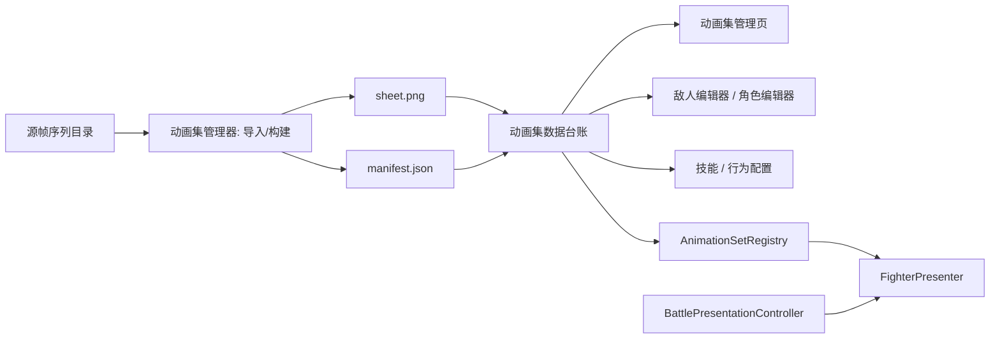

# 动画集管理器设计说明

创建时间：2026-06-06

状态：`规划中 / 待实现`

关联文档：

- `S2_战斗运行时/21-帧序列动画播放器与动画集配置补充设计.md`
- `S6_敌人系统与编辑器/28-敌人编辑器(enemy_editor)-设计说明.md`
- `S8_UI与交互基线/21-Spine素材制作工程与导入边界(spine_asset_pipeline)-设计说明.md`

## 1. 设计目标

动画集管理器是一个独立模块，用来把帧序列动画从“散落在文件夹里的图片资源”提升为“可管理、可查询、可预览、可引用、可发布”的正式资产。

它要解决的问题是：

1. 当前一共导入了多少套动画。
2. 每套动画归属于哪个角色、敌人、友军、召唤物或特效。
3. 每套动画包含哪些动作片段。
4. 每个动作片段的源素材、构建产物和播放属性是什么。
5. 哪些游戏对象、技能或敌人行为正在引用它。
6. 动画资源是否已经构建成功，是否存在缺帧、尺寸不一致、manifest 缺失等问题。
7. 战斗运行时如何通过稳定 ID 获取可播放 clip，而不是直接访问文件路径。

## 2. 非目标

本设计不做以下事情：

1. 不把动画集管理器塞进战斗播放器里。
2. 不要求战斗运行时现场合成 spritesheet。
3. 不让敌人编辑器直接管理底层帧图、sheet 路径和 manifest 细节。
4. 不用 GIF 作为正式战斗动画资产格式。
5. 不在第一阶段实现复杂权限、多人协作、云端资产库或版本分支管理。

## 3. 模块定位

动画集管理器同时具备四类能力：

| 能力 | 定位 |
| --- | --- |
| 数据管理 | 维护动画集台账、clip、资源状态、引用关系和构建历史 |
| 工具化 | 导入帧序列，构建 `sheet.png + manifest.json`，校验资源 |
| 服务化 | 向编辑器、主程序和战斗运行时提供查询、解析、校验接口 |
| 展示形态 | 提供独立动画集管理页面，展示列表、详情、预览、引用和错误 |

它不是一个隐藏的 JSON 文件，也不是一个只给运行时用的 registry。它必须有可见界面，让设计者能看到“当前有哪些动画资产，它们归属哪里，是否可用”。

## 4. 总体架构



核心边界：

1. 源帧序列是生产素材。
2. sheet 和 manifest 是构建产物。
3. 动画集数据台账是资产管理真源。
4. 角色、敌人、技能和行为只引用 `animationSetRef` 或 `animationKey`。
5. 战斗运行时通过 `AnimationSetRegistry` 解析 clip，然后交给 `FighterPresenter` 播放。

## 5. 数据模型

### 5.1 动画集

动画集是一个对象可用动画的集合。

```json
{
  "id": "enemy_001_default",
  "ownerType": "enemy",
  "ownerId": "enemy_001",
  "displayName": "敌人001 默认动画集",
  "defaultAnimation": "idle",
  "status": "ready",
  "clipCount": 3,
  "updatedAt": "2026-06-06T00:00:00+08:00"
}
```

字段说明：

| 字段 | 含义 |
| --- | --- |
| `id` | 动画集稳定 ID，供角色、敌人、运行时引用 |
| `ownerType` | 归属类型，例如 `player`、`enemy`、`ally`、`summon`、`effect` |
| `ownerId` | 归属对象 ID |
| `displayName` | 管理页展示名称 |
| `defaultAnimation` | 默认循环动作 |
| `status` | `draft`、`ready`、`warning`、`error` |
| `clipCount` | 动作片段数量 |
| `updatedAt` | 最近更新时间 |

### 5.2 动作片段

clip 是一个可播放动作。

```json
{
  "key": "attack1",
  "sourceDir": "source/character/敌人-001-状态001-正常状态-attack1",
  "sheetRef": "assets/animations/enemy_001/default/attack1.png",
  "manifestRef": "assets/animations/enemy_001/default/attack1.json",
  "frameWidth": 512,
  "frameHeight": 512,
  "columns": 8,
  "frameCount": 61,
  "fps": 18,
  "loop": false,
  "returnTo": "idle",
  "scale": 1.0,
  "offset": { "x": 0, "y": 0 },
  "status": "ready"
}
```

clip 只属于动画集管理器。敌人编辑器、技能编辑器和主程序不应该直接编辑 `sheetRef`、`frameWidth`、`columns` 这类字段。

### 5.3 引用关系

引用关系用于回答“这个动画集被谁使用”。

```json
[
  { "type": "enemy", "id": "enemy_001", "field": "animationSetRef" },
  { "type": "enemyAction", "id": "enemy_001.attack", "animationKey": "attack1" },
  { "type": "skill", "id": "slash", "animationKey": "attack1" }
]
```

第一阶段可以通过扫描配置文件生成引用关系；后续可以由编辑器在保存配置时同步维护。

### 5.4 构建状态

构建状态用于管理资源是否可用。

```json
{
  "animationSetId": "enemy_001_default",
  "clipKey": "attack1",
  "status": "ready",
  "sourceFrameCount": 61,
  "builtFrameCount": 61,
  "warnings": [],
  "errors": [],
  "builtAt": "2026-06-06T00:00:00+08:00"
}
```

常见错误包括：

1. 源目录不存在。
2. 帧命名不连续。
3. 帧尺寸不一致。
4. manifest 缺失。
5. sheet 缺失。
6. clip 被引用但不存在。

## 6. 独立管理界面

动画集管理器需要独立页面，不应隐藏在敌人编辑器或战斗页面里。

建议页面名称：

```text
动画集管理
```

### 6.1 页面职责

页面负责：

1. 查看所有动画集。
2. 按归属类型、归属对象、状态筛选。
3. 查看动画集详情。
4. 查看和编辑 clip 基础属性。
5. 导入源帧序列。
6. 构建 sheet 和 manifest。
7. 预览 clip 播放效果。
8. 查看引用关系。
9. 查看构建错误和资源告警。

### 6.2 页面布局

第一阶段推荐三栏结构：

```text
左侧：动画集列表 / 筛选
中间：动画集详情 / clip 表格
右侧：clip 预览 / 构建状态 / 引用关系
```

动画集列表字段：

| 字段 | 用途 |
| --- | --- |
| ID | 稳定引用 |
| 名称 | 人可读名称 |
| 归属 | player / enemy / ally / effect |
| 对象 | ownerId |
| clip 数 | 快速判断完整度 |
| 状态 | ready / warning / error |
| 更新时间 | 判断是否过期 |

clip 表格字段：

| 字段 | 用途 |
| --- | --- |
| key | 动作名 |
| fps | 播放速度 |
| loop | 是否循环 |
| returnTo | 非循环结束回到哪个动作 |
| frameCount | 帧数 |
| sheet | 构建产物 |
| status | 资源状态 |

### 6.3 预览能力

clip 预览必须播放运行时会消费的 sheet + manifest，而不是源帧序列。

预览区至少支持：

1. 播放 / 暂停。
2. 重播。
3. fps 预览。
4. 背景明暗切换，用于检查透明边缘。
5. 显示当前帧号。
6. 显示资源错误。

### 6.4 导入与构建

导入流程：

1. 选择或填写源帧序列目录。
2. 识别帧命名规则和帧数量。
3. 设置 clip key、fps、loop、returnTo、scale、offset。
4. 执行校验。
5. 生成 sheet + manifest。
6. 写入动画集台账。

第一阶段可以先使用路径输入和按钮触发构建；后续再做文件选择、拖拽导入和批量导入。

## 7. 服务化接口

动画集管理器应提供一组稳定接口。第一阶段可以是前端模块函数，后续可以升级为本地服务或编辑器后端 API。

建议接口：

```js
listAnimationSets(filter)
getAnimationSet(animationSetId)
findAnimationSetsByOwner(ownerType, ownerId)
resolveClip(animationSetId, animationKey)
validateAnimationSet(animationSetId)
listReferences(animationSetId)
buildClip(animationSetId, clipKey)
importClip(animationSetId, clipDraft)
```

接口边界：

1. 敌人编辑器使用 `findAnimationSetsByOwner` 和 `listAnimationSets` 做选择。
2. 技能或行为配置只保存 `animationKey`。
3. 战斗运行时使用 `resolveClip` 获取可播放 clip。
4. 构建工具使用 `buildClip` 生成或刷新 sheet。

## 8. 与其他模块的关系

### 8.1 与敌人编辑器

敌人编辑器只选择动画集和动作 key：

```json
{
  "animationSetRef": "enemy_001_default",
  "actionAnimations": {
    "idle": "idle",
    "attack": "attack1",
    "hit": "hit"
  }
}
```

敌人编辑器不直接维护源目录、sheet 路径、帧数、列数和 manifest。

### 8.2 与角色配置

角色配置只引用动画集：

```json
{
  "id": "player",
  "animationSetRef": "player_001_default",
  "defaultAnimation": "idle"
}
```

角色是否有 walk、idle、attack、hit，由动画集管理器中的 clip 决定。

### 8.3 与技能和行为配置

技能和敌人行为最多指定动画 key：

```json
{
  "id": "slash",
  "animationKey": "attack"
}
```

如果技能未指定，则战斗演出层可使用默认事件映射。

### 8.4 与战斗运行时

战斗运行时不扫描素材目录，也不合成 sheet。

它只做：

1. 根据角色或敌人读取 `animationSetRef`。
2. 根据事件或技能读取 `animationKey`。
3. 调用动画集管理器运行时侧解析 clip。
4. 把解析结果交给 `FighterPresenter` 播放。

### 8.5 与 S2 帧序列播放补充设计

`S2_战斗运行时/21-帧序列动画播放器与动画集配置补充设计.md` 描述的是战斗展示层如何消费动画集。

本设计描述的是动画集本身如何被导入、构建、管理、展示、查询和发布。

## 9. 分阶段实现建议

### 9.1 第一阶段：数据台账与只读页面

目标：

1. 建立动画集台账 JSON。
2. 把现有 player walk、enemy attack1 登记进去。
3. 做一个只读动画集管理页面。
4. 支持列表、详情、clip 预览和引用关系展示。

这个阶段不要求页面内完成构建，可以先消费已有 sheet 和 manifest。

### 9.2 第二阶段：导入与构建

目标：

1. 页面支持录入源目录。
2. 支持触发构建 sheet + manifest。
3. 支持校验帧尺寸、数量和命名。
4. 构建结果写回台账。

### 9.3 第三阶段：运行时接入

目标：

1. 实现 `AnimationSetRegistry`。
2. 让 `player.json / enemies.json` 只引用 `animationSetRef`。
3. 让 `FighterPresenter` 通过 `resolveClip` 获取播放数据。
4. 支持多 clip 切换、非循环动作 `returnTo` 和缺失动作降级。

### 9.4 第四阶段：编辑器联动

目标：

1. 敌人编辑器可选择动画集。
2. 角色配置页可选择动画集。
3. 技能或行为配置可选择动画 key。
4. 动画集管理页展示真实引用关系。

## 10. 验收标准

第一阶段验收标准：

1. 能打开独立动画集管理页面。
2. 能看到当前动画集总数。
3. 能看到每个动画集的归属类型和归属对象。
4. 能看到每个动画集下的 clip 列表和属性。
5. 能预览至少一个 player clip 和一个 enemy clip。
6. 能看到资源状态和构建错误。
7. 敌人编辑器和主程序不需要直接访问底层 sheet 路径。

完整阶段验收标准：

1. 可以从源帧序列导入并构建图集。
2. 构建产物自动登记到动画集台账。
3. 角色、敌人、技能、行为通过 `animationSetRef / animationKey` 引用动画。
4. 战斗运行时通过服务接口解析 clip。
5. 删除或修改动画集时能发现引用影响。
6. 缺失资源不影响战斗规则推进，只降级展示。

## 11. 设计结论

动画集管理器应作为独立模块建设。

它不是战斗播放器的附属功能，也不是敌人编辑器里的一个字段组。它是动画资产的管理入口，负责让动画资源从源素材进入正式游戏数据链路，并为主程序、敌人管理器、技能系统和战斗运行时提供稳定接口。

