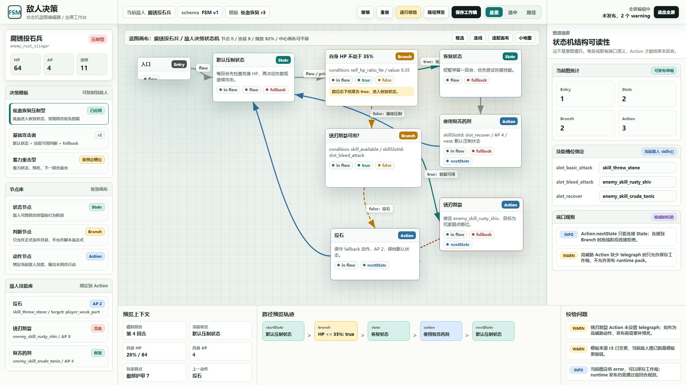
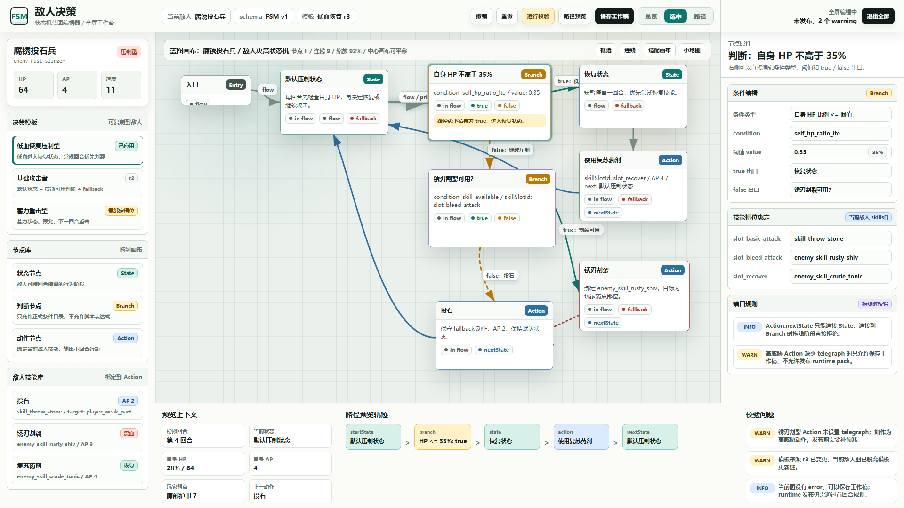
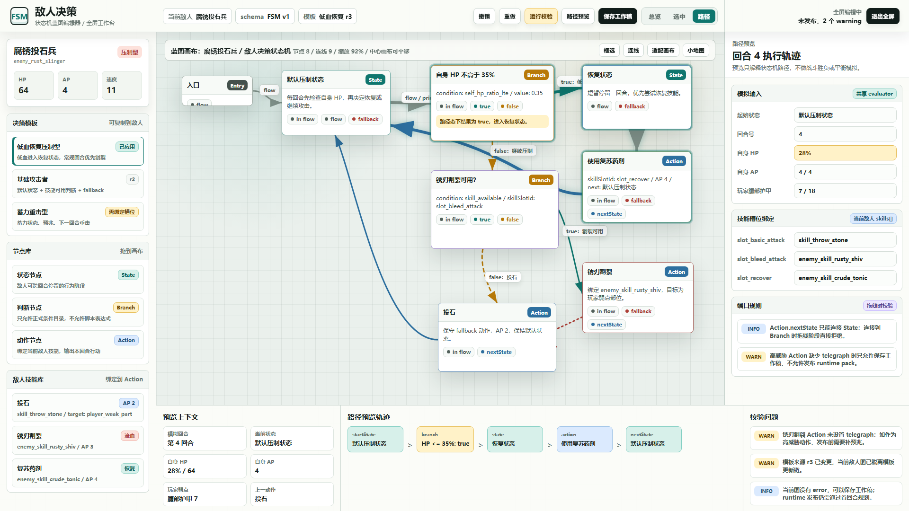

# 敌人决策状态机蓝图编辑器原型 v1

生成时间：2026-06-20 01:16:41

当前状态：`待用户确认`

适用 WBS / 页面：`S6_敌人系统与编辑器 / 敌人编辑器 / 敌人决策全屏编辑`

目标路由：`test/enemy_editor_v1.html` 的“敌人决策”全屏编辑模式

所属应用：`EnemyEditorPage`

页面主对象：`EnemyTemplate.enemyDecision`

目标画板规格：`1920 x 1080`

## 本版定位

本版重做“敌人决策”全屏编辑器的可评审原型。它不是继续美化旧的几个节点框，而是把正式设计文档中的敌人决策状态机规则转成具体工作台界面。

本版重点验证：

1. 全屏模式下是否以蓝图画布为主体。
2. 左侧是否同时承载决策模板、节点库和敌人技能库。
3. 中央画布是否能表达 State / Branch / Action 节点、端口和真实连线语义。
4. 右侧是否能编辑选中节点属性，而不是只读摘要。
5. 底部是否能表达路径预览、模拟上下文和校验问题。

## 非目标

1. 本版不改运行时代码。
2. 本版不接入真实拖拽、连线、保存和发布。
3. 本版不替代 `EnemyDecisionStateMachineEvaluator`、`Validator` 或 runtime 实现。
4. 本版不做移动端原型；敌人决策蓝图编辑器第一验收目标是桌面全屏工具。

## 共用事实源与设计依据

1. `DOC/CODEX_DOC/02_设计说明/S6_敌人系统与编辑器/29-敌人决策蓝图编辑器(enemy_decision_graph_editor)-补充设计说明.md`
2. `DOC/CODEX_DOC/02_设计说明/S6_敌人系统与编辑器/28-敌人编辑器(enemy_editor)-设计说明.md`
3. `DOC/CODEX_DOC/08_原型与附图/2026-05-24-敌人编辑器工作区原型-v1/README.md`
4. 当前运行页 `test/enemy_editor_v1.html` 中敌人决策全屏面板的评审意见。
5. 用户确认的方向：移除“意图循环”和旧“行为决策”，以“敌人决策状态机”作为唯一作者模型，不做向下兼容。

## 画板规格与布局预算

桌面主画板固定为 `1920 x 1080`。

布局预算：

1. 顶栏：68px，承载敌人、schema、模板、校验、路径预览、保存和退出全屏。
2. 左侧工具轨：330px，承载模板、节点库和敌人技能库。
3. 中央画布：1200px x 788px，是第一视觉主体。
4. 右侧属性面板：390px，承载图谱摘要、节点属性和预览输入。
5. 底部预览轨：224px，承载模拟上下文、路径轨迹和校验问题。

## 图文证据链

### 01-敌人决策蓝图总览态

评阅状态：`待用户确认`

画板规格：`1920 x 1080`

设计依据：

1. `29` 文档第 12 章要求“三栏一画布”。
2. `29` 文档第 8 章要求真实端口和连线规则。
3. `29` 文档第 10 章要求敌人技能库能绑定到 Action。

需要用户判断的问题：

1. 左侧模板、节点库、技能库是否是你希望的工具组织方式。
2. 中央画布的节点密度是否足够接近真实蓝图编辑器。
3. 总览态是否已经比旧原型更能表达“状态机”而不是“意图循环”。

允许偏差：实现时节点具体坐标可因布局算法和拖拽结果变化。

不可接受偏差：实现时不能把端口退回成单个“连出”按钮，不能把技能库退回成只读 chip。



### 02-低血判断节点选中态

评阅状态：`待用户确认`

画板规格：`1920 x 1080`

设计依据：

1. `29` 文档第 7.3 章要求 Branch 节点必须显示条件和 true / false 出口。
2. `29` 文档第 12.3 章要求属性面板可编辑，不是只读摘要。
3. `29` 文档第 9 章要求条件来自正式条件目录。

需要用户判断的问题：

1. 右侧属性面板是否足够表达“选中节点后能改条件、阈值、出口”。
2. Branch 节点上的 true / false 端口和连线标签是否足够直观。

允许偏差：实现时表单控件可使用项目已有下拉框、数字输入和选择器。

不可接受偏差：选中 Branch 后不能只显示 JSON；必须有结构化字段。



### 03-路径预览与校验态

评阅状态：`待用户确认`

画板规格：`1920 x 1080`

设计依据：

1. `29` 文档第 14 章要求路径预览使用和运行时相同的 evaluator。
2. `29` 文档第 13 章要求校验覆盖结构、技能和设计有效性。
3. `29` 文档第 6 章要求单回合从 currentState 开始求值，并在 Action 后更新 nextState。

需要用户判断的问题：

1. 底部路径轨迹是否足够清楚地回答“这一回合为什么走到这个动作”。
2. 右侧模拟输入是否应该继续保留在属性面板，还是独立成底部调试抽屉。

允许偏差：实现时路径轨迹可以用表格或事件列表表达。

不可接受偏差：路径预览不能变成战斗平衡模拟器；它只解释状态机路径。



## 原始材料说明

本版无外部原始图片。

`source/original/README.md` 记录了本版事实源来源。

## 原型到实现映射

目标运行入口：

1. `test/enemy_editor_v1.html`
2. 敌人编辑器中的“敌人决策”页签
3. 敌人决策页签的全屏编辑模式

建议实现组件组：

1. `EnemyDecisionGraphEditor`：全屏编辑器集成壳。
2. `EnemyDecisionGraphRenderer`：画布、节点、端口、连线、拖拽、缩放。
3. `EnemyDecisionTemplateStore`：模板 CRUD、应用模板、保存为模板。
4. `EnemyDecisionStateMachineValidator`：结构、技能、设计有效性校验。
5. `EnemyDecisionStateMachineEvaluator`：路径预览与运行时共享求值。

数据来源：

1. `assets/enemy_packs/current/enemies.json`
2. `EnemyTemplate.enemyDecision`
3. 当前敌人 `skills[]`
4. enemy pack `meta.enums`

验收方法：

1. 运行页面截图必须与本原型在结构、核心区域、入口位置、状态表达和视觉层级上对齐。
2. 运行页必须能展示真实端口、连线、节点属性编辑、模板入口、技能绑定入口、路径预览和校验问题。
3. 截图比对不能只证明元素存在，必须证明工作台形态与本原型一致。

## 允许偏差与不可接受偏差

允许偏差：

1. 节点坐标、线条弯曲方式和缩放比例可以因真实画布实现变化。
2. 字体渲染、局部间距、阴影强弱和按钮细节可以因现有设计系统调整。
3. 节点数量可以随当前敌人数据变化。

不可接受偏差：

1. 没有全屏工作台。
2. 没有真实端口。
3. 没有可编辑属性面板。
4. 没有敌人技能库到 Action 的绑定入口。
5. 模板功能只显示空壳，不能应用、复制或保存。
6. 路径预览没有模拟上下文、访问节点和选中动作。
7. UI 继续暴露旧“意图循环”或旧“行为决策”概念。

## 查看与再生成

从仓库当前 worktree 根目录查看源文件：

```powershell
Start-Process "NodeConsoleApp2/DOC/CODEX_DOC/08_原型与附图/2026-06-20-011641-NodeConsoleApp2-敌人决策状态机蓝图编辑器原型-v1/source/enemy-decision-blueprint-prototype-v1.html"
```

重新生成截图：

```powershell
node "NodeConsoleApp2/DOC/CODEX_DOC/08_原型与附图/2026-06-20-011641-NodeConsoleApp2-敌人决策状态机蓝图编辑器原型-v1/source/capture-enemy-decision-blueprint-prototype-v1.mjs"
```

截图脚本会输出：

1. `01-1920x1080-敌人决策蓝图总览态.png`
2. `02-1920x1080-低血判断节点选中态.png`
3. `03-1920x1080-路径预览与校验态.png`
4. `prototype-report.json`

## 评审结论与后续处理

当前结论：`待用户确认`

如果本版通过，后续实现必须把它作为敌人决策全屏编辑器的视觉与交互基准。实现完成后，需要提供运行页截图与本原型截图的对比结论。
