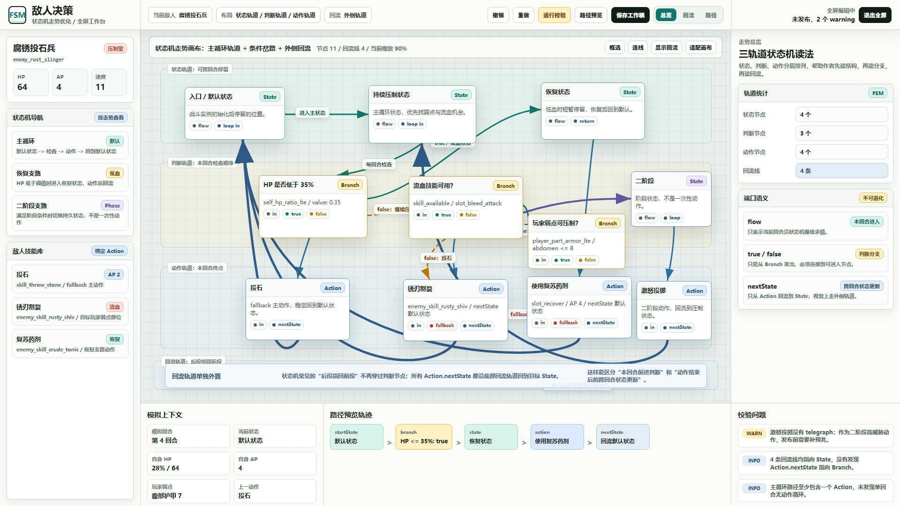
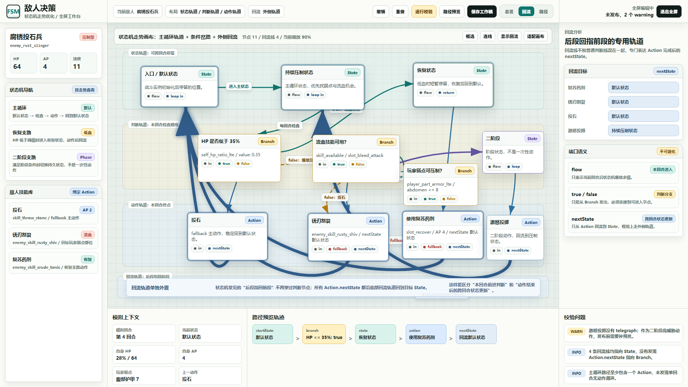
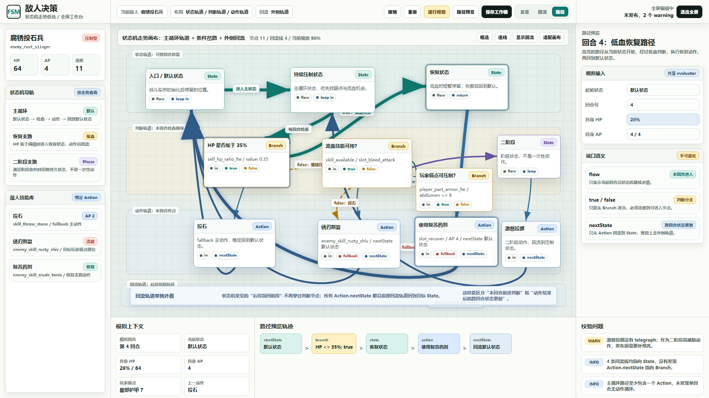

# 敌人决策状态机走势优化原型 v2

生成时间：2026-06-20 01:34:03

当前状态：`待用户确认`

适用 WBS / 页面：`S6_敌人系统与编辑器 / 敌人编辑器 / 敌人决策全屏编辑`

目标路由：`test/enemy_editor_v1.html` 的“敌人决策”全屏编辑模式

所属应用：`EnemyEditorPage`

页面主对象：`EnemyTemplate.enemyDecision`

目标画板规格：`1920 x 1080`

## 本版定位

本版继承 v1 的全屏蓝图工作台，但专门优化“状态机走势”。

v1 已经解决了抽象框过多、模板和技能库不具体、属性面板不够业务化的问题。用户对 v1 基本满意，但指出状态机图不同于一般蓝图逻辑图：状态机会有更多循环、后段回指前段、连续判断和跨回合状态更新。因此 v2 把画布重排为三条主轨道和一条外侧回流轨道。

本版重点验证：

1. 状态节点、判断节点、动作节点是否按不同语义分层排列。
2. 后段指回前段的 Action.nextState 是否能通过外侧回流轨道清楚表达。
3. 主循环、恢复支路、二阶段支路是否比 v1 更容易读。
4. 路径预览是否能同时表达“本回合前进判断”和“动作结束后的跨回合状态更新”。

## 非目标

1. 本版不修改运行时代码。
2. 本版不替换 `test/enemy_editor_v1.html`。
3. 本版不实现真实拖拽、连线、保存、发布或 evaluator。
4. 本版不新增移动端原型。
5. 本版不否定 v1 的工作台结构，只优化状态机画布走势。

## 共用事实源与设计依据

1. `DOC/CODEX_DOC/02_设计说明/S6_敌人系统与编辑器/29-敌人决策蓝图编辑器(enemy_decision_graph_editor)-补充设计说明.md`
2. `DOC/CODEX_DOC/02_设计说明/S6_敌人系统与编辑器/28-敌人编辑器(enemy_editor)-设计说明.md`
3. `DOC/CODEX_DOC/08_原型与附图/2026-06-20-011641-NodeConsoleApp2-敌人决策状态机蓝图编辑器原型-v1/README.md`
4. 用户评审意见：v1 效果基本满意，但需要进一步优化状态机走势，突出循环、判断和后段回指前段。

设计判断：

1. 状态机画布不应只是一般蓝图从左到右的 DAG 读法。
2. `flow / true / false` 代表本回合求值前进。
3. `Action.nextState` 代表动作结束后的跨回合状态更新，应视觉上走外侧回流轨道。

## 画板规格与布局预算

桌面主画板固定为 `1920 x 1080`。

布局预算：

1. 顶栏：64px，保留全屏编辑、保存、校验、路径预览和视图切换。
2. 左侧工具轨：300px，保留敌人摘要、状态机导航和敌人技能库。
3. 中央画布：主体区域，展示四条泳道：
   - 状态轨道：可跨回合停留。
   - 判断轨道：本回合检查顺序。
   - 动作轨道：本回合终点。
   - 回流轨道：动作结束后回到目标 State。
4. 右侧属性区：360px，随总览、回流、路径视图切换说明重点。
5. 底部轨迹区：220px，显示模拟上下文、路径预览轨迹和校验问题。

## 图文证据链

### 01-状态机走势总览态

评阅状态：`待用户确认`

画板规格：`1920 x 1080`

设计依据：

1. `29` 文档第 6 章要求每回合从 `decisionRuntime.currentStateId` 开始求值。
2. `29` 文档第 8 章要求真实端口，不允许单一“连出”。
3. 用户要求强化状态机循环和判断走势。

需要用户判断的问题：

1. “状态轨道 / 判断轨道 / 动作轨道 / 回流轨道”的读法是否更接近你想要的状态机编辑体验。
2. 主循环、恢复支路、二阶段支路是否能一眼看出。
3. 外侧回流轨道是否比 v1 的普通回线更清楚。

允许偏差：实现时具体节点坐标、回流弧线形状和线条避让算法可以变化。

不可接受偏差：实现时不能把回流线继续混在普通判断线里，导致 Action.nextState 和本回合 flow 难以区分。



### 02-回流轨道分析态

评阅状态：`待用户确认`

画板规格：`1920 x 1080`

设计依据：

1. `29` 文档第 6.2 章要求 Action 完成后按 `nextStateId` 更新 `currentStateId`。
2. `29` 文档第 8.1 章要求 Action 的 `nextState` 端口只连接 State。
3. 用户指出状态机会经常从后段指向前面。

需要用户判断的问题：

1. 高亮回流线是否足够清楚地表达“动作结束后的跨回合状态更新”。
2. 右侧“回流目标”列表是否应该成为后续运行页的一项固定辅助视图。

允许偏差：运行页可以用线条高亮、列表高亮或小地图高亮表达回流。

不可接受偏差：回流关系不能只藏在节点属性 JSON 中。



### 03-低血恢复路径态

评阅状态：`待用户确认`

画板规格：`1920 x 1080`

设计依据：

1. `29` 文档第 14 章要求路径预览使用共享 evaluator。
2. `29` 文档第 6.3 章允许跨回合循环，但禁止单回合无动作循环。
3. v1 已确认路径预览不是战斗平衡模拟器，只解释状态机路径。

需要用户判断的问题：

1. 高亮路径是否清楚表达“当前状态 -> 判断 -> 状态 -> 动作 -> 回流状态”。
2. 底部轨迹是否能作为设计者检查一回合行为的主要辅助工具。

允许偏差：实现时底部轨迹可以改为表格、树状列表或事件列表。

不可接受偏差：路径预览不能只显示最终动作，必须显示访问节点、条件结果和 nextState。



## 原始材料说明

本版无外部原始图片。

`source/original/README.md` 记录了 v1 继承来源和用户评审意见。

## 原型到实现映射

目标运行入口：

1. `test/enemy_editor_v1.html`
2. 敌人编辑器中的“敌人决策”页签
3. 敌人决策页签的全屏编辑模式

实现映射：

1. 状态轨道对应 State 节点布局分组。
2. 判断轨道对应 Branch 节点布局分组。
3. 动作轨道对应 Action 节点布局分组。
4. 回流轨道对应 Action.nextState 端口连接到 State。
5. 路径视图对应 `EnemyDecisionStateMachineEvaluator` 的 trace 输出。
6. 右侧“回流目标”对应 Validator 对 Action.nextState 的结构校验摘要。

验收方法：

1. 运行页截图需要和本原型在工作台结构、四轨道语义、回流高亮、底部路径轨迹上对齐。
2. 运行页必须能区分 `flow / true / false` 与 `nextState`。
3. 运行页至少需要一条可视化回流线，不能只把回流写在属性表单里。

## 允许偏差与不可接受偏差

允许偏差：

1. 真实画布可以自动布局，不要求固定坐标完全一致。
2. 线条可采用贝塞尔、折线或避让算法。
3. 节点数量可随敌人复杂度变化。
4. 颜色可按运行页设计系统微调。

不可接受偏差：

1. 状态、判断、动作没有语义分层。
2. 回流线和普通判断线无法区分。
3. `Action.nextState` 不是只能指向 State。
4. 路径预览不显示 nextState。
5. 仍出现旧“意图循环”或旧“行为决策”概念。

## 查看与再生成

查看源文件：

```powershell
Start-Process "NodeConsoleApp2/DOC/CODEX_DOC/08_原型与附图/2026-06-20-013403-NodeConsoleApp2-敌人决策状态机走势优化原型-v2/source/enemy-decision-stateflow-prototype-v2.html"
```

重新生成截图：

```powershell
node "NodeConsoleApp2/DOC/CODEX_DOC/08_原型与附图/2026-06-20-013403-NodeConsoleApp2-敌人决策状态机走势优化原型-v2/source/capture-enemy-decision-stateflow-prototype-v2.mjs"
```

截图脚本会输出：

1. `01-1920x1080-状态机走势总览态.png`
2. `02-1920x1080-回流轨道分析态.png`
3. `03-1920x1080-低血恢复路径态.png`
4. `prototype-report.json`

## 评审结论与后续处理

当前结论：`待用户确认`

如果本版通过，后续运行页实现应以 v2 作为敌人决策全屏编辑器的主要视觉基准。v1 保留为工作台结构的上一版证据，v2 替代 v1 的状态机画布走势表达。
