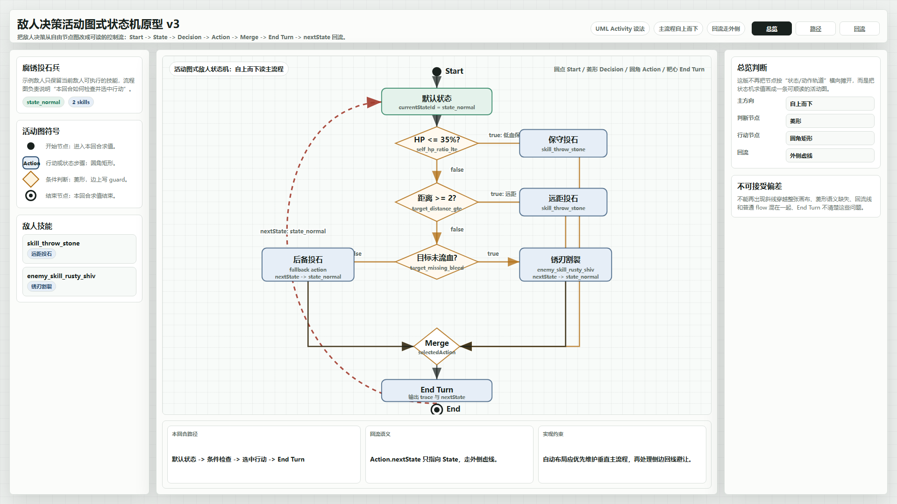
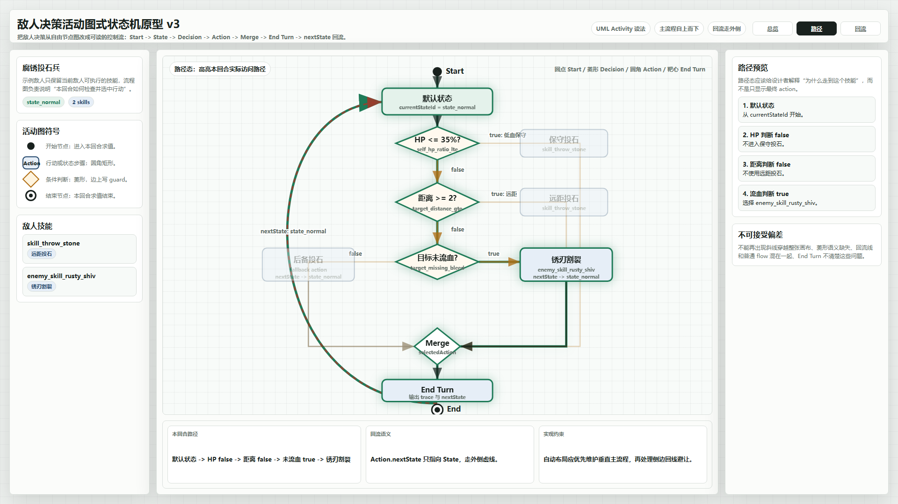
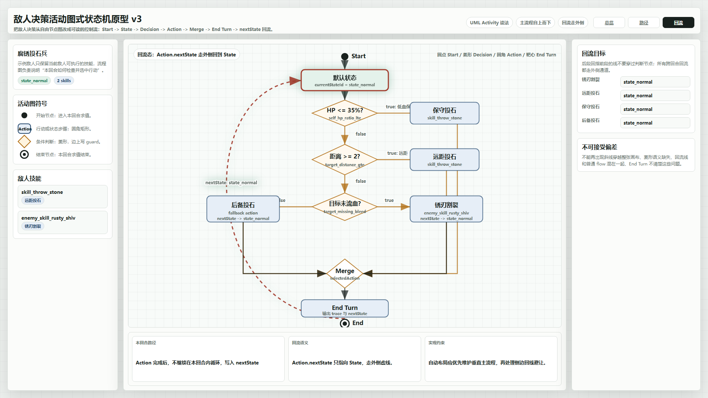

# 敌人决策活动图式状态机原型 v3

生成时间：2026-06-20 02:17:17

当前状态：`待用户确认`

适用 WBS / 页面：`S6_敌人系统与编辑器 / 敌人编辑器 / 敌人决策全屏编辑`

目标路由：`test/enemy_editor_v1.html` 的“敌人决策”全屏编辑模式

所属应用：`EnemyEditorPage`

页面主对象：`EnemyTemplate.enemyDecision`

目标画板规格：`1920 x 1080`

## 本版定位

本版回应用户对 v2 的核心批注：敌人决策状态机不应继续像自由蓝图节点图那样横向散开、斜线穿插，而应接近 UML Activity Diagram / 传统流程图的控制流读法。

本版从 v2 的“四轨道状态机”转为“活动图式状态机”：

1. 主流程自上而下。
2. 开始节点使用实心圆。
3. 普通步骤使用圆角矩形。
4. 条件判断使用菱形。
5. Merge 使用菱形汇合。
6. End Turn 使用圆角矩形，End 使用靶心终止符号。
7. `Action.nextState` 回流走左侧外圈虚线，不穿过主流程和判断节点。

## 非目标

1. 本版不修改运行时代码。
2. 本版不替换 `test/enemy_editor_v1.html`。
3. 本版不实现真实拖拽、连线、保存、发布或 evaluator。
4. 本版不处理移动端。
5. 本版不引入旧“意图循环”或旧“行为决策”概念。

## 共用事实源与设计依据

1. `DOC/CODEX_DOC/02_设计说明/S6_敌人系统与编辑器/29-敌人决策蓝图编辑器(enemy_decision_graph_editor)-补充设计说明.md`
2. `DOC/CODEX_DOC/02_设计说明/S6_敌人系统与编辑器/11-敌人系统(enemy_design)-设计说明.md`
3. `DOC/CODEX_DOC/08_原型与附图/2026-06-20-013403-NodeConsoleApp2-敌人决策状态机走势优化原型-v2/README.md`
4. 用户本轮提供的 UML Activity Diagram 参考图：`source/original/user-reference-activity-diagram.png`
5. 用户批注：希望整体状态机绘制效果类似传统活动图，而不是当前看起来逻辑混乱的顺序。

设计判断：

1. 敌人决策的作者视角应先理解“控制流顺序”，再理解各节点属性。
2. 自由节点拖拽仍可以存在，但自动布局的默认呈现应优先生成可顺读的活动图。
3. 回流是跨回合状态更新，不应和本回合普通 flow 混在同一组线里。

## 画板规格与布局预算

桌面主画板固定为 `1920 x 1080`。

布局预算：

1. 顶栏：72px，保留原型标题、设计口径和视图切换。
2. 左侧栏：300px，展示敌人摘要、活动图符号和技能库。
3. 中央画布：主体区域，展示活动图式状态机。
4. 右侧栏：350px，随总览、路径、回流视图展示判断重点。
5. 底部轨迹区：146px，展示本回合路径、回流语义和实现约束。

## 图文证据链

### 01-活动图式状态机总览态

评阅状态：`待用户确认`

画板规格：`1920 x 1080`

设计依据：

1. 用户参考图明确要求 Start 圆点、活动方块、判断菱形、回流箭头和 End。
2. `29` 文档要求编辑器服务状态机规则，不能用视觉效果掩盖不可执行模型。
3. v2 的横向轨道仍会产生斜线穿越和顺序混乱的问题。

需要用户判断的问题：

1. 这种自上而下的活动图读法，是否比 v2 更接近你想要的状态机编辑体验。
2. 左侧外圈 `nextState` 回流是否足够清楚。
3. 是否接受把默认自动布局从“轨道图”改成“活动图”。

允许偏差：实现时具体节点位置、线条避让、颜色和标签密度可以微调。

不可接受偏差：实现时不能再把判断节点画成普通方块，不能让回流线穿过主流程。



### 02-活动图式路径预览态

评阅状态：`待用户确认`

画板规格：`1920 x 1080`

设计依据：

1. `29` 文档要求路径预览显示访问节点、条件结果、选中 Action 和 nextState。
2. 用户指出当前顺序混乱，本图用绿色粗线解释“一回合实际走了哪条路”。
3. 路径预览不是战斗平衡模拟器，只解释状态机访问路径。

需要用户判断的问题：

1. 高亮路径是否足够清楚地表达“为什么走到这个技能”。
2. 右侧步骤列表是否应该成为后续运行页固定辅助视图。
3. 路径态是否还需要显示每个 guard 的 true / false 结果标签。

允许偏差：实现时路径高亮可以改为线条、节点边框、步骤列表三者组合。

不可接受偏差：路径预览不能只显示最终 action。



### 03-活动图式回流语义态

评阅状态：`待用户确认`

画板规格：`1920 x 1080`

设计依据：

1. `29` 文档要求 Action 的 `nextState` 只能指向 State。
2. 用户强调状态机会经常从后段指向前段，需要更清晰的回流。
3. v2 的底部回流轨道在当前运行页中仍然和普通线条视觉关系较近，本版改为左侧外圈回流。

需要用户判断的问题：

1. 左侧外圈虚线是否比底部回流轨道更清楚。
2. `Action.nextState` 回流是否应统一走外圈，而不是让每个 action 任意拉回线。
3. 回流目标列表是否需要在右侧常驻。

允许偏差：实现时可以根据节点密度把回流通道放左侧、右侧或外圈，但必须和普通 flow 分开。

不可接受偏差：回流关系不能只藏在节点属性 JSON 中。



## 原始材料说明

外部原始图片：

1. `source/original/user-reference-activity-diagram.png`

该图片影响本版的图形语义、主流程方向和回流表达方式。详见 `source/original/README.md`。

## 原型到实现映射

目标运行入口：

1. `test/enemy_editor_v1.html`
2. 敌人编辑器中的“敌人决策”页签
3. 敌人决策页签的全屏编辑模式

实现映射：

1. Start 对应 `entry` 节点。
2. 圆角矩形对应 State 或 Action 节点。
3. 菱形对应 Branch 和 Merge 语义。
4. End Turn 对应本回合 Action 选择完成并输出 trace。
5. 外侧虚线回流对应 `Action.nextState`。
6. 右侧路径列表对应 evaluator trace。

验收方法：

1. 运行页截图需要和本原型在活动图符号、主流程方向、判断菱形、外侧回流和路径预览上对齐。
2. 运行页必须能区分 `flow / guard` 与 `nextState`。
3. 至少一个示例敌人的决策图能在默认布局下自上而下读通。

## 允许偏差与不可接受偏差

允许偏差：

1. 真实画布可以自动布局，不要求固定坐标完全一致。
2. 线条可以采用折线、贝塞尔或正交避让算法。
3. 节点数量可随敌人复杂度变化。
4. 右侧信息区可按运行页现有组件微调。

不可接受偏差：

1. 状态机默认图仍是横向自由散点图。
2. 条件判断不使用菱形。
3. 回流线穿过主流程或和普通 flow 无法区分。
4. End Turn / End 语义不清楚。
5. 路径预览不显示条件结果和 nextState。

## 查看与再生成

查看源文件：

```powershell
Start-Process "NodeConsoleApp2/DOC/CODEX_DOC/08_原型与附图/2026-06-20-021717-NodeConsoleApp2-敌人决策活动图式状态机原型-v3/source/enemy-decision-activity-diagram-prototype-v3.html"
```

重新生成截图：

```powershell
node "NodeConsoleApp2/DOC/CODEX_DOC/08_原型与附图/2026-06-20-021717-NodeConsoleApp2-敌人决策活动图式状态机原型-v3/source/capture-enemy-decision-activity-diagram-prototype-v3.mjs"
```

截图脚本会输出：

1. `01-1920x1080-活动图式状态机总览态.png`
2. `02-1920x1080-活动图式路径预览态.png`
3. `03-1920x1080-活动图式回流语义态.png`
4. `prototype-report.json`

## 自检结论

截图脚本已在 `1920 x 1080` 视口生成三张图。

`prototype-report.json` 记录：

1. 三张图均无节点重叠。
2. 三张图均无水平溢出。
3. 三张图均无垂直溢出。
4. 每张图包含 12 个节点、3 个判断节点、5 个行动/步骤节点和 1 条回流线。

## 评审结论与后续处理

当前结论：`待用户确认`

如果本版通过，后续运行页实现应以 v3 作为敌人决策全屏编辑器的视觉基准，v2 保留为上一轮状态机轨道方案证据。
